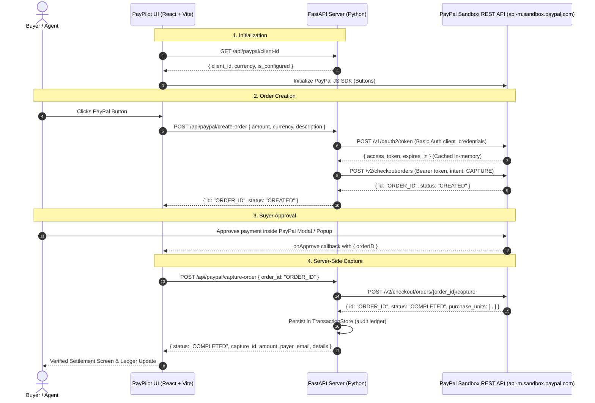

# 🚀 PayPilot AI

> **PayPal AI Hackathon Project**  
> Autonomous Agent Payment Orchestration & Intelligent PayPal Sandbox Checkout Dashboard.

[](https://fastapi.tiangolo.com)
[](https://react.dev)
[](https://vitejs.dev)
[](https://python.org)
[](https://developer.paypal.com)
[](LICENSE)

---

## 💡 Overview

**PayPilot AI** is an intelligent payment copilot engineered for the PayPal AI Hackathon. It bridges natural language autonomous AI agent workflows with the official **PayPal Sandbox REST API v2**.

### Key Architectural Highlights
- 🛡️ **Zero Client-Side Secret Exposure**: PayPal Client Secret and OAuth 2.0 token exchanges remain strictly in backend memory. The frontend never sees or logs the client secret.
- ⚡ **Official PayPal REST Orders API**: Orders are created (`POST /v2/checkout/orders`) and captured (`POST /v2/checkout/orders/{id}/capture`) server-side via backend endpoints.
- 🎯 **Real Sandbox Settlement**: No fake success states. Transaction confirmation is strictly bound to the verified `COMPLETED` capture status from PayPal Sandbox.
- 💎 **Modern Fintech Dashboard**: High-polish dark glassmorphic UI, responsive layout, structured AI payment prompt parsing, live transaction ledger, and PayPal Buttons SDK.
- 🔄 **SDK v5 to v6 Upgrade Ready**: Uses the stable PayPal JS SDK standard checkout via `@paypal/react-paypal-js` with a modular architecture ready for SDK v6 adoption.

---

## 🏛️ System Architecture



---

## 📁 Project Structure

```text
paypilot-ai/
├── backend/
│   ├── app/
│   │   ├── routers/
│   │   │   ├── __init__.py
│   │   │   ├── health.py             # GET /health
│   │   │   └── paypal.py             # Client ID, Orders, Captures, Ledger
│   │   ├── schemas/
│   │   │   ├── __init__.py
│   │   │   └── paypal.py             # Pydantic models & currency validators
│   │   ├── services/
│   │   │   ├── __init__.py
│   │   │   └── paypal_service.py     # OAuth2 token caching, Orders v2 client
│   │   ├── storage/
│   │   │   ├── __init__.py
│   │   │   └── transaction_store.py  # Thread-safe in-memory transaction store
│   │   ├── config.py                 # Environment settings & credentials masking
│   │   └── main.py                   # FastAPI app with CORS & lifespan
│   ├── tests/
│   │   └── test_paypal_api.py        # Pytest test suite (7 automated tests)
│   ├── .env.example                  # Backend environment placeholders
│   ├── requirements.txt              # FastAPI, Uvicorn, Pydantic, HTTPX, Pytest
│   └── run.py                        # Convenience backend launcher
│
├── frontend/
│   ├── public/
│   │   └── favicon.svg               # PayPilot AI brand icon
│   ├── src/
│   │   ├── components/
│   │   │   ├── AIPaymentRequest.tsx   # AI prompt builder & presets
│   │   │   ├── ConfigHelperModal.tsx  # Interactive Sandbox setup assistant
│   │   │   ├── Navbar.tsx             # Fintech header & live health badges
│   │   │   ├── PayPalCheckoutArea.tsx # PayPal JS SDK Buttons wrapper
│   │   │   ├── RecentTransactions.tsx # Real capture ledger & details modal
│   │   │   └── TransactionStatus.tsx  # Verified PayPal settlement screen
│   │   ├── services/
│   │   │   └── api.ts                 # Typed backend REST client
│   │   ├── types/
│   │   │   └── index.ts               # Shared TypeScript definitions
│   │   ├── App.css                    # Component styling & micro-animations
│   │   ├── App.tsx                    # Root dashboard orchestrator
│   │   ├── index.css                  # Design system tokens & typography
│   │   └── main.tsx                   # React entry point
│   ├── package.json
│   ├── tsconfig.json
│   └── vite.config.ts                # Vite with backend API reverse proxy
│
├── .env.example                      # Root environment reference
├── .gitignore                        # Comprehensive secrets & virtualenvs ignore
└── README.md                         # Documentation
```

---

## 🛠️ Prerequisites (Windows)

Ensure you have installed:
- **Node.js**: v18+ or v20+ (`node -v`)
- **Python**: 3.10+ (`python --version`)
- **PayPal Developer Account**: [developer.paypal.com](https://developer.paypal.com)

---

## ⚡ Quick Start Instructions (Windows PowerShell)

### Step 1: Open Terminal in the Project Directory
```powershell
cd paypilot-ai
```

---

### Step 2: Configure PayPal Sandbox Credentials

1. Go to the [PayPal Developer Dashboard &rarr; Apps & Credentials](https://developer.paypal.com/dashboard/applications/sandbox).
2. Ensure you are on the **Sandbox** tab. Create or select a REST API application.
3. Copy your **Client ID** and **Secret Key**.
4. In `backend/`, create a `.env` file from `.env.example`:
```powershell
Copy-Item backend\.env.example backend\.env
```
5. Open `backend\.env` in your editor and enter your credentials:
```env
PAYPAL_CLIENT_ID=your_paypal_sandbox_client_id_here
PAYPAL_CLIENT_SECRET=your_paypal_sandbox_client_secret_here
PAYPAL_API_BASE=https://api-m.sandbox.paypal.com
PAYPAL_CURRENCY_DEFAULT=USD
HOST=0.0.0.0
PORT=8005
```

> **Note:** If you start the app without credentials, the dashboard will gracefully show a setup guide with clickable steps and instructions rather than crashing.

---

### Step 3: Run the Backend (Python FastAPI)

In PowerShell:
```powershell
# Navigate to backend
cd backend

# Create virtual environment (if not already created)
python -m venv .venv

# Activate virtual environment
.\.venv\Scripts\Activate.ps1

# Install dependencies
pip install -r requirements.txt

# Start backend server
python run.py
```

The backend server starts at:  
👉 **http://localhost:8005**  
Interactive Swagger API documentation:  
👉 **http://localhost:8005/docs**

---

### Step 4: Run the Frontend (React Vite)

Open a **second PowerShell window**:
```powershell
# Navigate to frontend
cd paypilot-ai\frontend

# Install dependencies
npm install

# Start Vite dev server
npm run dev
```

The frontend application starts at:  
👉 **http://localhost:5173**

---

## 🧪 Testing the Solution

### 1. Automated Backend Tests
Run the automated pytest test suite in the backend directory:
```powershell
cd backend
.\.venv\Scripts\python -m pytest
```
*Expected output: `7 passed`.*

### 2. Frontend Production Build Check
Validate that TypeScript compiles with zero warnings or errors:
```powershell
cd frontend
npm run build
```

### 3. End-to-End Sandbox Payment Flow
1. Open `http://localhost:5173` in your browser.
2. Select an AI Preset (e.g. *AI Compute Credits - $25.00*) or type a custom natural language prompt into the PayPilot Copilot assistant.
3. Click the **PayPal Button**.
4. A PayPal Sandbox authentication window will appear.
5. Log in with a **PayPal Sandbox Personal Buyer account** (obtainable from PayPal Developer &rarr; Sandbox &rarr; Accounts).
6. Click **Complete Purchase**.
7. The dashboard immediately calls the backend to capture the order.
8. The screen updates to show the verified **Payment Successfully Captured** receipt, complete with:
   - Real Capture ID
   - Order ID
   - Buyer Email
   - Net Settlement & Fees
   - Inspectable JSON response from PayPal Sandbox
9. The transaction appears in the **Recent Transactions** ledger.

---

## 📡 REST API Reference

| Method | Endpoint | Description |
| :--- | :--- | :--- |
| `GET` | `/health` | Service health status & PayPal configuration readiness flag |
| `GET` | `/api/paypal/client-id` | Returns public PayPal Client ID for SDK initialization (secret is never sent) |
| `POST` | `/api/paypal/create-order` | Creates an order on PayPal Sandbox via `POST /v2/checkout/orders` |
| `POST` | `/api/paypal/capture-order` | Captures an approved order on PayPal Sandbox via `POST /v2/checkout/orders/{id}/capture` |
| `GET` | `/api/paypal/order/{order_id}` | Retrieves order details from PayPal Sandbox |
| `GET` | `/api/paypal/transactions` | Lists recent verified sandbox captures |

---

## 🔒 Security Best Practices Implemented

- **No Secrets on Client**: The PayPal client secret is never bundled or sent to the browser.
- **Sanitized Logging**: All server logs mask sensitive credentials and never log bearer tokens or secret keys.
- **Token Caching**: OAuth 2.0 access tokens are cached safely with a 60-second expiration buffer to prevent redundant round-trips.
- **Strict Input Validation**: Pydantic validates ISO currency codes and decimal values before any external PayPal API call is triggered.
- **Idempotency**: Requests use unique `PayPal-Request-Id` UUIDs to avoid accidental double charges.

---

## ⚖️ License
MIT &copy; 2026 PayPilot AI Team
